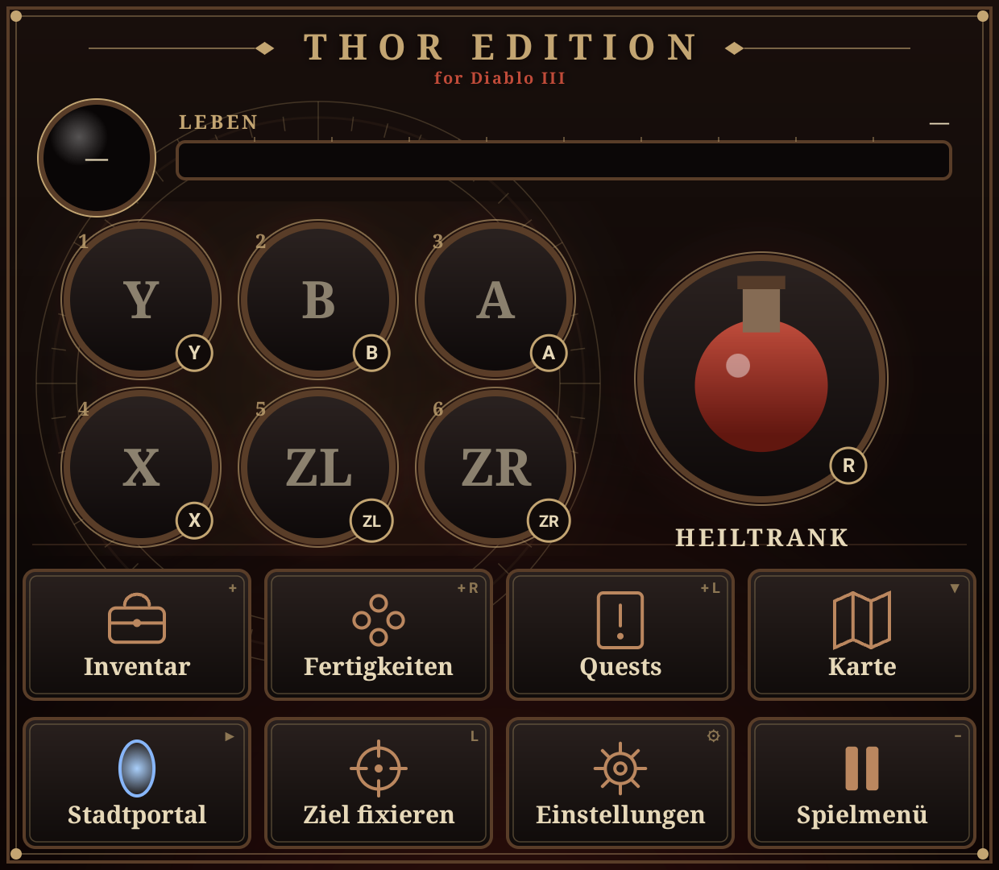

# Thor Edition for D3

**A dual-screen port for Diablo III on the AYN Thor:** the game on the top screen, a touch control deck on the second screen.

> Not affiliated with or endorsed by Blizzard Entertainment, Microsoft or Nintendo. Requires your own legally purchased copy.
> This repository and its APK contain no game program, data, art, text or keys.

This is a fork of **[Diablo III Mobile](https://github.com/Desm0nt/diablo3-port)** by **Desm0nt** — a native ARM64 Android port
(HLE of the Switch system services, NVN replayed on Vulkan), itself derived from **d2r-mobile** (MIT). All of the engine work is
theirs; this fork adds the Thor-specific parts below.



## What the Thor Edition adds

- **Control deck on the bottom screen** (1240×1080): life bar and resource globe read live from the game's own HUD (tinted in your
  class's resource colour), the six skill buttons showing your equipped skills' icons, a large potion button, and big buttons for
  Inventory, Skills, Quests, Map, Town Portal, Lock Target, Game Menu and the port's settings. The deck never takes focus, so the
  built-in controller keeps playing while you tap.
- **Clean top screen**: the on-screen touch pad and the FPS counter are off; the game fills the 1920×1080 screen (16:9).
- **Game data on the SD card**: if `Download/Diablo3Mobile` has no `romfs`, the app uses `<SD card>/Diablo3Mobile` (the Thor's
  internal storage is often too small).
- **Buttons as printed** (right face button = A confirms): put the line `DM_PAD_LAYOUT=label` into `Diablo3Mobile/dm/env`.

Tested on the AYN Thor (Snapdragon 8 Gen 2 / Adreno 740, Android 13): title, hero creation and Act 1 at a steady 60 fps.

## Setup

Preparing the game folder works exactly as in the upstream project — follow its guide:
**https://github.com/Desm0nt/diablo3-port** (`docs/INSTALL.md`). Then copy the finished `Diablo3Mobile` folder to the Thor's
SD card root (or `Download/`) and install the APK from the [Releases](../../releases) page.

## Building

Android SDK + NDK (r28/r29), CMake ≥ 3.22, Ninja, JDK 17+, Gradle ≥ 9.6, Python 3, PowerShell:

```sh
git clone --recursive https://github.com/harmssi/thor-d3
cmake -S dm/android -B work/build-android -G Ninja \
  -DCMAKE_TOOLCHAIN_FILE=$ANDROID_NDK_HOME/build/cmake/android.toolchain.cmake \
  -DANDROID_ABI=arm64-v8a -DANDROID_PLATFORM=android-31 -DCMAKE_BUILD_TYPE=Release -DDM_GAME=d3
pwsh tools/build_apk.ps1          # -> work/D3-port-debug.apk (app id org.diablo3.port)
```

The Thor code lives in `dm/android/app/src/main/java/com/xiaoboluo/d2r/ThorDeck.java` and `ThorScreens.java`; the launcher icon
is generated by `thor/make_icon.py` (original art). The gamepad skin packs of the upstream front end are not included in this fork.

## Credits & license

- **Desm0nt** — [Diablo III Mobile / diablo3-port](https://github.com/Desm0nt/diablo3-port) (the port itself)
- the **d2r-mobile** authors (see [LICENSE](LICENSE)) — the HLE host and renderer this all derives from
- **seedds** — nx2android front-end parts
- Mesa Turnip, libadrenotools and the other components listed in [docs/THIRD_PARTY.md](docs/THIRD_PARTY.md)

MIT License — see [LICENSE](LICENSE); all upstream copyright notices apply unchanged, the Thor additions are under the same license.
Diablo is a trademark of Blizzard Entertainment, Inc.; used here only to describe compatibility.
